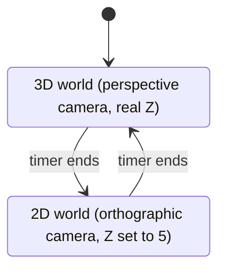
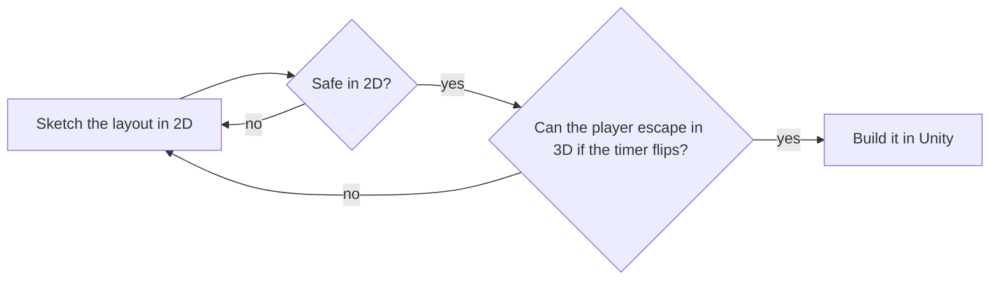

## Overview

The jam theme was **Unstable World**. My idea was a platformer whose world keeps flipping between 2D and 3D by itself. Every stretch of the level is a puzzle, because a path that is safe in 2D can be dangerous in 3D, and the other way round. The player cannot choose when it flips, which is what makes the world feel unstable.

Two full versions of a level in 24 hours was not realistic, so I looked for a way to get both from one set of objects. I prototyped it, and Sujal implemented it in the game.
## Team

| Name | Role | What they did |
| --- | --- | --- |
| Shreyas Shejwal | Game Designer and Technical Designer | Concept, level design, Z-flattening prototype |
| Sujal | Game Programmer | Implemented the dimension switch and core gameplay |
| Himanshu | UI Programmer and Generalist | UI and general support |
| Harshaanad | Game Artist | Art |


## Systems and mechanics

### The Z-flattening trick

The game is 3D by default. Every obstacle and platform the level designer places has a real Z position. To go to 2D, the camera switches to orthographic and everything is moved onto one shared Z plane, so nothing is in front of or behind anything else. To go back to 3D, each object returns to the Z value saved for it. The level layout is stored in the objects themselves, so there is only one level to build and test.



The prototype I wrote, cleaned up for display (names and constants only, logic unchanged). Sujal built the production version from it.

```csharp
const float PlaneZ = 5f;           // shared plane for everything in 2D

void SwitchTo2D()
{
    is2D = true;
    mainCamera.CameraSwitch2D();
    savedPlayerZ = Player.transform.position.z;      // remember where the player was in 3D

    if (mainCamera.orthographic)                      // only flatten once the camera has switched
        SetZ(Player.transform, PlaneZ);

    foreach (var p in Platforms) SetZ(p.transform, PlaneZ);
    playerController.Set2DMode(true);
}

void SwitchTo3D()
{
    is2D = false;
    mainCamera.CameraSwitch3D();
    SetZ(Player.transform, savedPlayerZ);             // player returns to where they were
    playerController.Set2DMode(false);

    for (int i = 0; i < Platforms.Length; i++)        // platforms return to their designed Z
        SetZ(Platforms[i].transform, platformZ[i]);
}
```

   


### Player controller in 2D

When the world flattens, the player has to stay on the plane. `Set2DMode` places the player on the shared Z, turns them to face sideways, and zeroes the Z velocity so physics cannot push them off the plane.

```csharp
public void Set2DMode(bool state)
{
    is2D = state;
    if (!is2D) return;

    var pos = transform.position;
    pos.z = 5f;
    transform.position = pos;

    transform.rotation = Quaternion.Euler(0f, 90f, 0f);   // face sideways
    rb.linearVelocity = new Vector3(rb.linearVelocity.x, rb.linearVelocity.y, 0f);  // no drift off the plane
}
```

## Level design

Level design took most of my time and was harder than I expected. I drew every layout on paper in 2D first, then asked one question: if the player is stuck in 2D when the timer ends, can they still get out in 3D? Because the flip is forced, every state has to be solvable from the other one, or the player is trapped.



Switching runs on a timer and the levels are designed around it. Interval: `TODO seconds`.

## Game design and polish

The mechanic worked, but the switch itself had no feedback: no screen shake, no transition effect, no audio cue. The judges liked the bold choice and the game placed as runner-up, but it lacked game feel. I took that lesson into my next project, FairShots, and added game feel from the start.

## Key takeaways

- **Scope decides the design.** The Z-flattening trick came from having 24 hours, and it turned out simpler and more reliable than two separate worlds.
- **Paper first.** Sketching in 2D and checking the 3D escape was slower than building straight in Unity, but it caught unsolvable layouts early.
- **Hand over clear intent.** I designed and prototyped the idea and Sujal implemented it, so the final game matched the design.
- **Next time,** I would add feedback to the switch first: a short screen shake, a transition effect and a sound.


